# SurgiVision AI

Understanding surgical workflow through computer vision.

A PyTorch ResNet + causal LSTM research pipeline, FastAPI video service, and Next.js/TypeScript/Tailwind dashboard with Radix/shadcn-style controls. Supports authorized recorded video, offline causal analysis, and chronological streaming simulation. No model weights, surgical footage, or fabricated benchmark results are included.

[Private dashboard preview](https://surgivision-research-mmr.marceloruiz147.chatgpt.site) · [Dashboard screenshot](docs/dashboard.png)

**Research and educational software only. Not clinically validated or intended for patient care, intraoperative guidance, or surgical decision-making.**

## Quick start

Python 3.9+ (3.11 recommended), Node 24, and several GB of disk space are needed. ResNet-50 training generally benefits from a GPU; cached features and ResNet-18 reduce development costs. Actual hardware throughput must be measured.

```bash
python3 -m venv .venv
source .venv/bin/activate
pip install '.[test]'
cp .env.example .env
uvicorn backend.app.main:app --host 127.0.0.1 --port 8000
```

In another terminal:

```bash
cd frontend
npm ci
npm run dev
```

Open http://127.0.0.1:3000 . API documentation is at http://127.0.0.1:8000/docs . The dashboard connects to the local API by default; configure another API and an optional in-memory bearer token in connection settings. A static hosted dashboard contains no Python inference runtime and requires a separately hosted HTTPS API with a matching CORS origin. The full application runs locally using the commands above or `docker compose up --build` after copying `.env.example` to `.env`.

The API loads environment variables from its process. For direct uvicorn use, export the desired variables in your shell; copying `.env` alone is for Docker Compose and does not load it into uvicorn.

## Dataset, training, evaluation

Read [dataset access and labels](docs/DATASET.md) before obtaining footage. Review the current CC BY-NC-SA 4.0 terms at [CAMMA](https://camma.unistra.fr/datasets/). No automatic dataset download is performed.

```bash
python -m scripts.prepare --data data/cholec80 --output data/prepared --fps 1 --authorized
python -m scripts.cache_features --data data/prepared
python -m ml.training.train --data data/prepared --output runs
mkdir -p models
python -m ml.evaluation.benchmark --data data/prepared --checkpoint runs/RUN_ID/best.pt --output models/metrics.json
```

Frozen CNN feature training is the default. Configuration lives in `ml/configs/default.yaml`. Set `model: cnn` for the frame-level baseline. Set `fine_tune: last` or `full` and pass `--frames` for end-to-end training. Evaluate fine-tuned CNNs with `--frames`. Checkpoint selection uses validation loss; test cases never affect training or selection. TensorBoard logs loss, accuracy, macro/per-class F1 and learning rate. Checkpoints save configuration, split, seed, epoch and duration. CUDA mixed precision is enabled only on CUDA; MPS and CPU fall back to full precision. Gradient clipping, early stopping, and ReduceLROnPlateau are included. Train-only class weighting and focal loss are optional experiments.

Copy a trusted, trained checkpoint to `models/active.pt` or set `SURGIVISION_CHECKPOINT`; set `SURGIVISION_METRICS` to its measured evaluation report. The service deliberately returns HTTP 503 when a trained checkpoint is absent. ImageNet pretrained CNN weights may be downloaded by torchvision during research preparation; these alone are not a trained surgical classifier.

[Metric definitions and benchmark protocol](docs/EVALUATION.md) describe fair comparisons, temporal metrics and ablations. No real surgical training or evaluation was performed in this delivery because no authorized local footage was supplied. The official [CAMMA reference](https://github.com/CAMMA-public/Surgical-Phase-Recognition) is a TensorFlow CNN–biLSTM–CRF implementation trained on Cholec120. Its published metrics are not ours. This project uses an independently implemented PyTorch causal architecture and does not bundle the reference weights or code.

## Architecture

```mermaid
flowchart LR
 V[Authorized recorded video] --> D[Sequential OpenCV decoder]
 D --> P[1 FPS / RGB / 224 × 224 / ImageNet normalization]
 P --> C[ResNet-50: 2048 spatial features]
 C --> L[Causal 2-layer LSTM: 512 hidden units]
 L --> H[Linear / dropout / 7 phase logits]
 H --> S[Softmax / optional causal EMA]
 S --> A[FastAPI jobs or WebSocket transport]
 A --> U[Video / timeline / probability visualization]
```



A CNN encodes spatial patterns; the LSTM adds past-frame context. Training consumes raw logits with cross-entropy or focal loss. Streaming retains recurrent state and optional smoothed probabilities. A seek resets state and rebuilds it by replaying the video prefix; this can take time and emits a warming state. Only observations at or before the displayed timestamp are revealed. No expected phase order is enforced. Low-confidence outputs are flagged; softmax is not calibrated clinical certainty. Optional bidirectional LSTM is available for full-sequence offline experiments and rejected by the streaming predictor.

## API and data lifecycle

- `POST /api/videos/upload?authorized=true` accepts multipart video, validates extension, size and decoding, uses random storage names and mode 0600 files.
- `POST /api/videos/{id}/analyze` queues offline inference (one active worker, bounded queue).
- `GET /api/videos/{id}/results`, `/timeline`, `/content` return results or video.
- `DELETE /api/videos/{id}` deletes an inactive upload.
- `GET /api/models`, `/api/models/active/metrics`, `/api/health` expose availability and measured reports.
- `WS /api/stream/{id}`: first send `{"token":"..."}`; then `{"action":"resume"}`, `pause`, `seek` with `time`, `reset`, or `stop`. Each session owns its model state. Server serializes inference sessions to bound accelerator use.
- `POST /api/videos/{id}/gradcam?seconds=...` replays past frames and returns the current-frame attribution map. It does not establish anatomical safety or explain causal reasoning.

Uploads expire after 24 hours by default (`SURGIVISION_RETENTION_SECONDS`). A janitor removes expired inactive files every minute. Results are in memory and disappear after restart; orphan files still expire. Processing pins active files until completion. No patient frames or filenames are written to application logs. Decoder resources close on failures and disconnects. Offline data preparation artifacts require separate deletion by the researcher.

The API is intended for localhost or a protected research network. Set `SURGIVISION_API_TOKEN` before exposing it, restrict CORS, terminate TLS, enforce reverse-proxy request/body/time limits, and provision encrypted storage according to your institution's requirements. This is single-process research software: use one uvicorn worker. A durable job queue, restart recovery, multi-user authorization, encryption/key management, rate limiting, VFR decoding, live hardware ingestion and a clinical deployment validation program are not implemented.

## Verification

```bash
pytest -q
cd frontend && npm run build
```

Tests create a non-patient synthetic video in temporary storage. They cover decoding, normalization, alignment, disjoint cases, ResNet shapes, variable sequence lengths, checkpoint rejection, hidden-state reset, prefix causality, segmentation, metrics, Grad-CAM, auth and upload validation. Hardware tests run where available. An explicit synthetic smoke path exercises actual training and evaluation:

```bash
python -m scripts.synthetic_smoke --output /tmp/surgivision-smoke
python -m ml.training.train --data /tmp/surgivision-smoke --config /tmp/surgivision-smoke/smoke.yaml --output /tmp/surgivision-smoke/runs
# Substitute the emitted RUN_ID. These are engineering artifacts, not surgical results.
python -m ml.evaluation.benchmark --data /tmp/surgivision-smoke --checkpoint /tmp/surgivision-smoke/runs/RUN_ID/best.pt --output /tmp/surgivision-smoke/engineering-report.json
```

Never install synthetic smoke checkpoints as surgical models. See `docs/VERIFICATION.md` for checks performed on the delivery machine.

## Limitations

No surgical performance, confidence calibration, safety assessment, complication detection or cross-hospital generalization has been established. OpenCV sampling assumes constant frame rate. The streaming simulation samples recorded video at one frame/second and reports computation lag; it is not live operating-room ingestion. Grad-CAM is exploratory attribution, not proof of why a phase was selected. Storage, authentication and queue design are a local research baseline. Dataset and third-party dependency licenses are separate from original project code; no claim of redistribution rights is made for patient data.

## Deploy the dashboard on Vercel

Import this repository in Vercel and set the Root Directory to `frontend`.
The Next.js build exports the dashboard as static files. In Connection settings,
point the dashboard at your separately hosted HTTPS inference API and allow
the dashboard origin in the API's CORS configuration.
