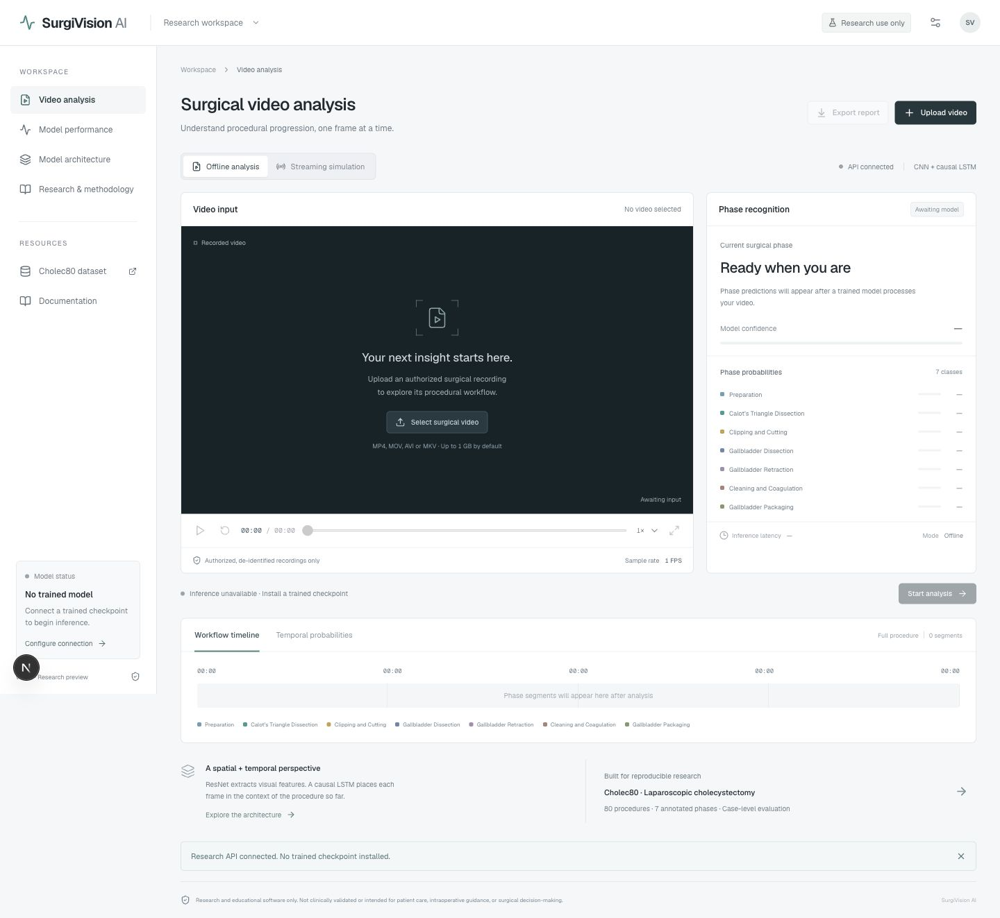

# Verification record

Run on November 7, 2026, on Apple Silicon with Python 3.9.6, PyTorch 2.8.0, torchvision 0.23.0, and Node 24.18.0. See `requirements-tested.txt` and the frontend lockfile for the observed dependencies.

- `pytest -q`: **17 passed, one skipped** (CUDA hardware absent). Apple MPS inference ran. Grad-CAM uses a CPU model copy on MPS because native one-step LSTM backward failed during integration testing.
- Generated non-patient video fixtures exercised API upload, actual model forward passes, offline jobs, WebSocket restart/seek, timeline generation and attribution. Temporary test weights are generated and removed by pytest.
- Actual optimizer steps and checkpoint creation ran on one synthetic epoch each for the frozen-feature CNN baseline, frozen-feature causal LSTM, and last-block fine-tuning with synthetic frames. The held-out evaluator completed against synthetic embeddings and synthetic frames. These engineering runs do not estimate performance on surgical videos.
- `npm run build`: static Next.js production build and TypeScript checks passed. `npm audit --omit=dev --audit-level=high`: zero reported vulnerabilities in the production npm dependency tree at verification time.
- Browser checks at 1440, 1024, and 390 CSS pixels covered layout, upload authorization gating, architecture navigation, and unavailable metrics. The private deployment returned a successful production URL and the browser displayed its sign-in gate.

No authorized real cases were processed. No surgical model or benchmark is included.

